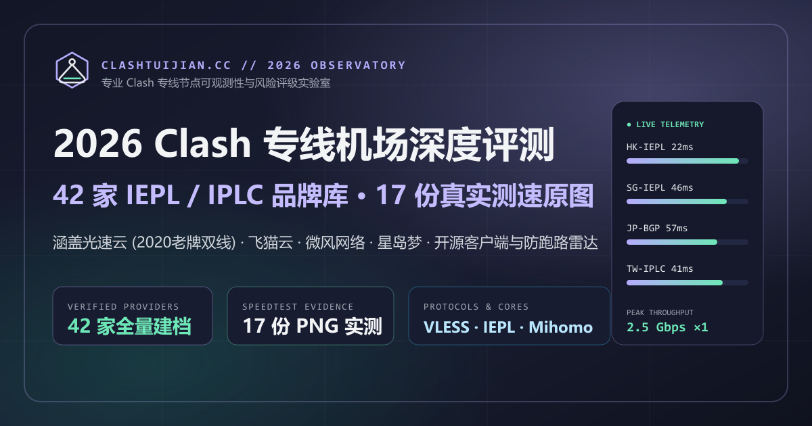

<div align="center">


# ClashTuijian.cc

**2026 专线网络可观测性评测实验室与开源客户端技术矩阵**

[](https://clashtuijian.cc)
[](https://astro.build)
[](#核心架构特性)
[](#seo-与-geo-基础设施)
[](./LICENSE)

<br />



</div>

---

## 项目简介

**ClashTuijian.cc** 是一个基于 **Astro 7** 纯静态生成（SSG）架构构建的高性能网络可观测性资料站与专线评测知识库。项目聚焦 `IEPL` / `IPLC` 物理内网专线、`VLESS-Reality` / `Hysteria 2` / `Trojan` 现代传输协议以及 `Mihomo` / `sing-box` 开源代理生态，提供无重型前端框架运行时负担的毫秒级静态直出体验。

### 核心架构特性

- **42 家结构化品牌档案库 + 三级数据溯源隔离**
  - 严格区分 **实测原图核验（Measured + Vendor，附 17 份 `2026-08-11` 原始节点测速 PNG）**、**当期公开参数（Vendor Verified）** 与 **历史归档样本（Historical Archive）**，零虚构星级评分。
- **三大万字级工程专题支柱页**
  - **免费资源与开源生态库（`/guides/resources`）**：全平台开源客户端官方 GitHub Releases 索引、四大分流规则集（MetaCubeX / Loyalsoldier / ACL4SSR / blackmatrix7）、IP 欺诈值检测工具箱与防 DNS 泄露 YAML 覆写模板。
  - **客户端排障与协议百科（`/guides/faq`）**：支持即时检索与 6 大技术分类过滤的 24 条深度工程问答。
  - **风险分层与防失联雷达（`/guides/warnings`）**：基于专线硬件成本模型的 6 大预警信号拆解与双备份容灾方案。
- **生产级 SEO 与生成式引擎（GEO）友好设计**
  - **零跳变 URL 规范**：采用 `trailingSlash: 'never'` + `build.format: 'file'` 物理文件直出架构，全站 Canonical、Open Graph 与 Sitemap `100%` 零重定向对齐。
  - **知识图谱与结构化抽取**：内置统一 [`SeoHead.astro`](src/components/SeoHead.astro) 元数据组件，输出归一化 `@graph` JSON-LD（`WebSite`、`Organization`、`CollectionPage`、`Article`、`FAQPage`、`BreadcrumbList`），首屏配备 Answer-First 摘要框与原生语义化 `<table>` 参数矩阵。
  - **自动化 Sitemap 路由发现**：基于 Vite `import.meta.glob` 动态扫描收录新增页面，自动排除 `404`、`noindex` 与草稿路由。
- **60fps 原生 CSS 变量滚动动效引擎**
  - 依托轻量级 [`scroll.js`](src/scripts/scroll.js) 与自托管 WOFF2 字体，无第三方统计追踪脚本或外部字体请求阻塞首屏渲染（LCP）。

---

## 目录结构

```text
clashtuijian.cc/
├── public/
│   ├── favicon.svg                  # 站点矢量图标
│   └── media/
│       ├── brand/                   # 品牌徽标 (mark.svg & 512×512 logo-512.png)
│       ├── hero/                    # 首屏视觉与 1200×630 Open Graph 预览图 (og-cover.png)
│       ├── speedtests/              # 17 份 2026-08-11 原始节点测速 PNG 档案
│       └── ...                      # 专题矢量插画资产
├── src/
│   ├── components/
│   │   ├── SeoHead.astro            # 全站统一 SEO Head、站长验证插槽与 JSON-LD 引擎
│   │   ├── Nav.astro                # 桌面/移动端零 JS 爬虫友好主导航
│   │   ├── GuidesNav.astro          # 六维专题矩阵交叉内链导航
│   │   └── ...                      # 首页各视差与榜单视图组件
│   ├── data/
│   │   ├── brands.ts                # 42 家品牌结构化参数、套餐、测速与 FAQ 数据源
│   │   ├── clients.ts               # 全平台开源代理客户端官方仓库索引
│   │   ├── guides-resources.ts      # 免费开源工具、规则集与 Mihomo YAML 模板数据
│   │   ├── guides-faq.ts            # 6 大分类排障百科知识库数据
│   │   └── guides-warnings.ts       # 风险信号与四级分层评级数据
│   ├── layouts/
│   │   └── Layout.astro             # 全局页面外壳与静态资源挂载
│   ├── pages/
│   │   ├── index.astro              # 首页 (Top 5 扇形陈列 + Top 10 榜单与二维对比表)
│   │   ├── about.astro              # 评测方法论、三级数据溯源准则与合规免责声明
│   │   ├── 404.astro                # 独立 HTTP 404 页面 (noindex, nofollow)
│   │   ├── robots.txt.ts            # 标准 RFC 9309 爬虫协议端点
│   │   ├── sitemap.xml.ts           # 自动发现式 XML Sitemap 生成端点
│   │   ├── brands/
│   │   │   ├── index.astro          # 42 家品牌实时筛选检索库
│   │   │   └── [slug].astro         # 42 个动态生成的品牌独立评测与协议适配页
│   │   └── guides/
│   │       ├── index.astro          # 专题指南总导航中心
│   │       ├── resources.astro      # 免费资源与开源工具生态库
│   │       ├── faq.astro            # 机场百科与故障排障知识库
│   │       └── warnings.astro       # 跑路预警与风险分层中心
│   ├── scripts/
│   │   └── scroll.js                # 视口滚动进度与 3D 卡片交互控制器
│   ├── styles/
│   │   └── global.css               # 全局设计令牌 (Design Tokens) 与响应式样式表
│   ├── config.ts                    # 站点主域、导航、首页模块配置与站长验证槽位
│   └── utils.ts                     # 静态资源路径解析与规范化 Canonical URL 工具
├── astro.config.mjs                 # Astro 静态构建与 URL 尾斜杠策略配置
├── package.json
└── tsconfig.json
```

---

## 页面与端点矩阵

| 路由路径 | 编译产物 (`dist/`) | 页面类型 | 索引策略 | Schema.org 结构化类型 |
| :--- | :--- | :--- | :---: | :--- |
| `/` | `index.html` | 首页与 Top 10 核心矩阵 | `index, follow` | `WebSite`, `Organization`, `ItemList`, `FAQPage` |
| `/brands` | `brands.html` | 42 家品牌检索与对比总库 | `index, follow` | `CollectionPage`, `BreadcrumbList`, `ItemList` |
| `/brands/[slug]` | `brands/*.html` (×42) | 品牌深度评测与客户端内核适配 | `index, follow` | `Article`, `BreadcrumbList`, `FAQPage` |
| `/guides` | `guides.html` | 专题知识矩阵导航中心 | `index, follow` | `CollectionPage`, `BreadcrumbList` |
| `/guides/resources` | `guides/resources.html` | 免费开源客户端与分流规则库 | `index, follow` | `Article`, `BreadcrumbList`, `FAQPage` |
| `/guides/faq` | `guides/faq.html` | 协议原理与客户端排障百科 | `index, follow` | `FAQPage`, `BreadcrumbList` |
| `/guides/warnings` | `guides/warnings.html` | 风险预警信号与分层评级表 | `index, follow` | `Article`, `BreadcrumbList`, `FAQPage` |
| `/about` | `about.html` | 实验室方法论与合规免责声明 | `index, follow` | `AboutPage`, `BreadcrumbList`, `FAQPage` |
| `/404` | `404.html` | 异常路由兜底引导页 | `noindex, nofollow` | `WebSite`, `Organization` |
| `/sitemap.xml` | `sitemap.xml` | 49 条规范网址站点地图 | `HTTP 200 XML` | XML Sitemap 0.9 |
| `/robots.txt` | `robots.txt` | 全搜索引擎抓取规则声明 | `HTTP 200 Text` | RFC 9309 Robots |

---

## 快速开始

### 环境要求

- **Node.js**: `>= 20.0.0`
- **包管理器**: `npm`（项目锁定 [`package-lock.json`](./package-lock.json)）

### 本地开发与构建命令

```bash
# 1. 安装依赖
npm install

# 2. 启动本地热更新开发服务器
npm run dev

# 3. 执行生产级静态编译（产物输出至 ./dist）
npm run build

# 4. 本地预览生产静态构建产物
npm run preview
```

---

## 部署与搜索引擎站长验证配置

### 1. 静态托管参数（Cloudflare Pages / Vercel / Nginx）

- **Build command**: `npm run build`
- **Build output directory**: `dist`
- **主域规范化重定向**：建议在 DNS / 边缘规则层将 `http://clashtuijian.cc/*` 与 `https://www.clashtuijian.cc/*` 统一配置单跳 `301` 重定向至 `https://clashtuijian.cc/$1`。

### 2. 四大搜索引擎站长平台验证（零 JS 静态注入）

项目已在 [`src/config.ts`](src/config.ts) 与 [`src/components/SeoHead.astro`](src/components/SeoHead.astro) 预留静态 `<meta>` 验证标签插槽。在托管平台配置以下任一构建环境变量（或直接填入 `src/config.ts` 的 `siteVerification` 字段）并触发构建，即可在全站 HTML `<head>` 静态直出对应验证标签：

```ini
PUBLIC_GOOGLE_SITE_VERIFICATION=""   # Google Search Console (google-site-verification)
PUBLIC_BING_SITE_VERIFICATION=""     # Bing Webmaster Tools (msvalidate.01)
PUBLIC_SHENMA_SITE_VERIFICATION=""   # 神马站长平台 (shenma-site-verification)
PUBLIC_BAIDU_SITE_VERIFICATION=""    # 百度搜索资源平台 (baidu-site-verification)
```

---

## 合规与免责声明

1. 本仓库与站点仅作为网络通信协议架构、开源代理客户端配置与可观测性数据的技术资料汇编，**不经营、不销售、不托管任何网络节点服务**。
2. 所有测速快照仅反映特定时间戳与测试机房拓扑下的单次采样记录，不构成对任何第三方服务商长期连接质量的承诺。
3. 请严格遵守所在国家及地区的互联网法律法规，仅将相关网络知识用于合法的跨境商务办公、国际学术检索与软件工程研发协作。

## License

Released under the [MIT License](./LICENSE).
